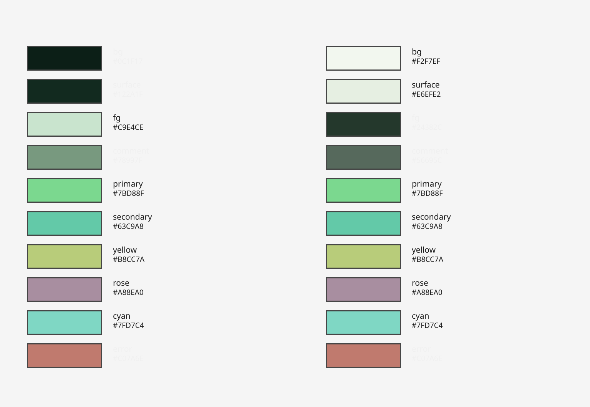

# Greenit


Green-injected terminal, editor, and shell theme family. Like energreen but slightly greener — every neutral hue-shifted toward green, every accent a green derivative.

**Generated theme family.** Every artifact is rendered from a single `palette.json` by `gen.py` (stdlib only). Run `make gen` to regenerate, `make check` to verify no drift.

Two variants: **Dark** (`greenit`) and **Light** (`greenit-light`).

## Preview



WCAG AA: dark fg/bg = 12.64:1, light fg/bg = 11.52:1.

## How it works

| File | Purpose |
|------|---------|
| `palette.json` | Single source of truth — all color values, both variants |
| `gen.py` | Stdlib-only renderer; reads `palette.json`, renders every artifact |
| `templates/*.tmpl` | One template per app format |
| `Makefile` | `make gen` renders all artifacts; `make check` regenerates + `git diff --exit-code` |

**Byte-identical proof:** `make check` leaves `git diff` empty — generated output matches the committed files exactly, proving the templates faithfully reproduce the theme family.

## Quick Install

### Vim / Neovim

```bash
git clone https://github.com/Mark44928/Greenit.git
cp Greenit/colors/greenit.vim ~/.vim/colors/
cp Greenit/colors/greenit-light.vim ~/.vim/colors/
```

```vim
" ~/.vimrc or init.vim
set termguicolors
colorscheme greenit        " dark
" colorscheme greenit-light  " light
```

### Terminal emulators

**Kitty**
```bash
cp extras/kitty.conf ~/.config/kitty/greenit.conf
# add to kitty.conf:  include greenit.conf
```

**Alacritty**
```bash
mkdir -p ~/.config/alacritty/themes
cp extras/alacritty.toml ~/.config/alacritty/themes/greenit.toml
# add to alacritty.toml:  import = ["~/.config/alacritty/themes/greenit.toml"]
```

**Ghostty**
```bash
cp extras/ghostty ~/.config/ghostty/greenit
# add to config:  include = ~/.config/ghostty/greenit
```

**WezTerm**
```bash
cp extras/wezterm.lua ~/.config/wezterm/greenit.lua
# in ~/.wezterm.lua:  require("greenit")
```

**iTerm2**
Open iTerm2 → Preferences → Profiles → Colors → Color Presets → Import → select `extras/greenit.itermcolors`.

**Windows Terminal**
Import `extras/windows-terminal.json` via **Settings → Color schemes → Import**.

**Termux**
```bash
cp termux/greenit-dark.properties ~/.termux/colors.properties && termux-reload-settings
# light variant:
cp termux/greenit-light.properties ~/.termux/colors.properties && termux-reload-settings
```

### Shell & prompt

**Emacs** (`greenit-dark-theme.el` / `greenit-light-theme.el`)
```elisp
;; ~/.emacs.d/init.el or ~/.emacs
(add-to-list 'custom-theme-load-path "$HOME/repos/Greenit/emacs")
(load-theme 'greenit-dark t)   ;; or 'greenit-light
```

**Fish shell** (`greenit-dark.theme` / `greenit-light.theme`)
```fish
# Install via fish_config → select "Greenit dark" / "Greenit light"
# Or set manually:
cp fish/greenit-dark.theme ~/.config/fish/themes/
fish_config
```

**Powerlevel10k** (`greenit-dark.zsh` / `greenit-light.zsh`)
```zsh
source "$HOME/repos/Greenit/powerlevel10k/greenit-dark.zsh"
# or: source "$HOME/repos/Greenit/powerlevel10k/greenit-light.zsh"
```

**git** (`greenit-dark.config` / `greenit-light.config`)
```ini
# ~/.gitconfig
[include]
    path = "$HOME/repos/Greenit/git/greenit-dark.config"
```

**git-delta** (`greenit-dark.config` / `greenit-light.config`)
```ini
# ~/.gitconfig
[include]
    path = "$HOME/repos/Greenit/delta/greenit-dark.config"
[delta]
    features = greenit-dark   # or greenit-light
```

**lsd** (`greenit-dark.colors.yaml` / `greenit-light.colors.yaml`)
```yaml
# ~/.config/lsd/config.yaml
color:
  theme: custom
```
```bash
cp lsd/greenit-dark.colors.yaml ~/.config/lsd/colors.yaml
```

**exa** (`greenit-dark.colors` / `greenit-light.colors`)
```bash
export EXA_COLORS="$(cat exa/greenit-dark.colors)"
```

**ripgrep** (`greenit-dark.rc` / `greenit-light.rc`)
```bash
export RIPGREP_CONFIG_PATH="$HOME/repos/Greenit/ripgrep/greenit-dark.rc"
```

**less** (`greenit-dark.termcap` / `greenit-light.termcap`)
```bash
. "$HOME/repos/Greenit/less/greenit-dark.termcap"
```

**fastfetch** (`greenit-dark.jsonc` / `greenit-light.jsonc`)
```bash
cp fastfetch/greenit-dark.jsonc ~/.config/fastfetch/config.jsonc
# light variant:
cp fastfetch/greenit-light.jsonc ~/.config/fastfetch/config.jsonc
# or load directly:
fastfetch -c fastfetch/greenit-dark.jsonc
```

**yazi** (`greenit-dark.toml` / `greenit-light.toml`)
```bash
cp yazi/greenit-dark.toml ~/.config/yazi/theme.toml
# light variant:
cp yazi/greenit-light.toml ~/.config/yazi/theme.toml
```

**helix** (`greenit-dark.toml` / `greenit-light.toml`)
```bash
cp helix/greenit-dark.toml ~/.config/helix/themes/greenit-dark.toml
# light variant:
cp helix/greenit-light.toml ~/.config/helix/themes/greenit-light.toml
# then in ~/.config/helix/config.toml:  theme = "greenit-dark"
```

**lazygit** (`greenit-dark.yml` / `greenit-light.yml`)
```bash
cp lazygit/greenit-dark.yml ~/.config/lazygit/greenit-dark.yml
# light variant:
cp lazygit/greenit-light.yml ~/.config/lazygit/greenit-light.yml
# then: lazygit --use-config-file ~/.config/lazygit/config.yml,~/.config/lazygit/greenit-dark.yml
```

**nano** (`greenit-dark.nanorc` / `greenit-light.nanorc`)
```bash
cp nano/greenit-dark.nanorc ~/.config/nano/nanorc
# light variant:
cp nano/greenit-light.nanorc ~/.config/nano/nanorc
# or add to ~/.nanorc:  include ~/.config/nano/nanorc
```

**zellij** (`greenit-dark.kdl` / `greenit-light.kdl`)
```bash
mkdir -p ~/.config/zellij/themes
cp zellij/greenit-dark.kdl ~/.config/zellij/themes/
# light variant:
cp zellij/greenit-light.kdl ~/.config/zellij/themes/
# then in ~/.config/zellij/config.kdl:  theme "greenit-dark"
```

### Syntax highlighting & tools

**bat** (`greenit-dark.tmTheme` / `greenit-light.tmTheme`)
```bash
mkdir -p "$(bat --config-dir)/themes"
cp bat/greenit-dark.tmTheme "$(bat --config-dir)/themes/"
bat cache --build
bat --theme Greenit-dark file.rs
# light: bat --theme Greenit-light
```

**fzf** (`greenit-dark.sh` / `greenit-light.sh`)
```bash
. "$HOME/repos/Greenit/fzf/greenit-dark.sh"
# or add to ~/.zshrc / ~/.bashrc
```

**dircolors** (`greenit-dark` / `greenit-light`)
```bash
eval "$(dircolors -b dircolors/greenit-dark)"
# light: eval "$(dircolors -b dircolors/greenit-light)"
```

**starship** (`greenit-dark.toml` / `greenit-light.toml`)
```bash
cp starship/greenit-dark.toml ~/.config/starship.toml
# light: cp starship/greenit-light.toml ~/.config/starship.toml
```

**tmux** (`greenit-dark.conf` / `greenit-light.conf`)
```bash
tmux source-file "$HOME/repos/Greenit/tmux/greenit-dark.conf"
# light: tmux source-file "$HOME/repos/Greenit/tmux/greenit-light.conf"
```

**btop** (`greenit-dark.theme` / `greenit-light.theme`)
```bash
cp btop/greenit-dark.theme ~/.config/btop/themes/
# set color_theme = "greenit-dark" in btop.conf
```

## Verify the Colorscheme

```bash
# Dark variant — Normal must show guifg/#C9E4CE guibg/#0C1F17, name prints 'greenit'
vim -u NONE -N -c "set t_Co=256 rtp+=$HOME/repos/Greenit" \
    -c "colorscheme greenit" -c "hi Normal" -c "echo g:colors_name" -c "qa!"

# Light variant — Normal must show guifg/#24382C guibg/#F2F7EF, name prints 'greenit-light'
vim -u NONE -N -c "set t_Co=256 rtp+=$HOME/repos/Greenit" \
    -c "colorscheme greenit-light" -c "hi Normal" -c "echo g:colors_name" -c "qa!"
```

## Generator workflow

```bash
make gen       # render every artifact from palette.json
make check     # regenerate, fail on git diff (drift detection), node --check where applicable
```

## Palette

| Role | Dark | Light |
|------|------|-------|
| bg | `#0C1F17` | `#F2F7EF` |
| surface | `#122A1F` | `#E6EFE2` |
| fg | `#C9E4CE` | `#24382C` |
| comment | `#78997F` | `#56695C` |
| primary | `#7BD88F` | `#7BD88F` |
| secondary | `#63C9A8` | `#63C9A8` |
| yellow | `#B8CC7A` | `#B8CC7A` |
| rose | `#A88EA0` | `#A88EA0` |
| cyan | `#7FD7C4` | `#7FD7C4` |
| error | `#C07A6E` | `#C07A6E` |

## ANSI 16-Color Table

Bright colors (8–15) are visibly lighter variants of their normal counterparts (1–7), per the recipe. No duplicates.

| Var | Dark | Light |
|-----|------|-------|
| color0 | `#1A331C` | `#E6EFE2` |
| color1 | `#A88EA0` | `#C07A6E` |
| color2 | `#7BD88F` | `#7BD88F` |
| color3 | `#B8CC7A` | `#B8CC7A` |
| color4 | `#63C9A8` | `#63C9A8` |
| color5 | `#A88EA0` | `#A88EA0` |
| color6 | `#7FD7C4` | `#7FD7C4` |
| color7 | `#A7C4A3` | `#C9E4CE` |
| color8 | `#78997F` | `#56695C` |
| color9 | `#D4B4C0` | `#E49A8E` |
| color10 | `#9BEDAF` | `#9BEDAF` |
| color11 | `#D4E49A` | `#D4E49A` |
| color12 | `#8FE4C4` | `#8FE4C4` |
| color13 | `#D4B4C0` | `#D4B4C0` |
| color14 | `#A7EBDC` | `#A7EBDC` |
| color15 | `#C9E4CE` | `#FFFFFF` |

## Contributing

See [CONTRIBUTING.md](CONTRIBUTING.md) for adding terminal emulators, changing the palette, and submitting PRs.

**The ripple rule:** changing a color means changing it everywhere — `palette.json`, `colors/*.vim`, `termux/*.properties`, `extras/*`, `templates/*`, `palette.md`, and this README.

## License

[MIT](LICENSE)
