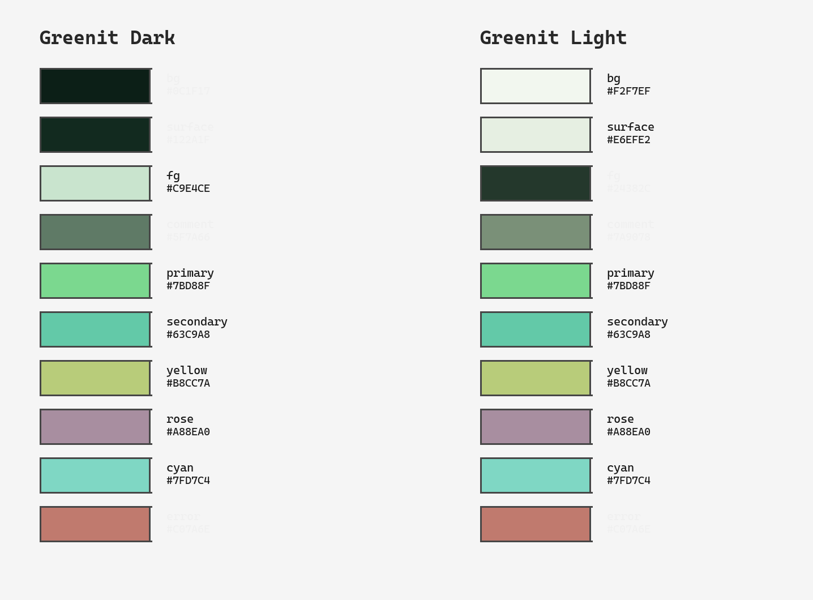

# Greenit Palette

Greenit is a green-injected theme family — like energreen but slightly greener.
Every neutral is hue-shifted toward green (grays → sage/moss), and every accent
is a green derivative. Two variants: **Dark** and **Light**.

## WCAG Contrast (measured)

Ratios are foreground/background. WCAG 2.0 AA requires ≥ 4.5:1 for normal text.

| Variant | Pair            | Ratio | Pass AA |
|---------|-----------------|-------|---------|
| Dark    | fg / bg         | 12.64 | yes     |
| Dark    | primary / bg    | 9.85  | yes     |
| Dark    | error / bg      | 5.11  | yes     |
| Dark    | rose / bg       | 5.75  | yes     |
| Dark    | cyan / bg       | 10.15 | yes     |
| Dark    | secondary / bg  | 8.54  | yes     |
| Dark    | yellow / bg     | 9.77  | yes     |
| Dark    | comment / bg    | 3.65  | no*     |
| Dark    | color0 / bg     | 1.25  | no*     |
| Dark    | color8 / bg     | 3.65  | no*     |
| Light   | fg / bg         | 11.52 | yes     |
| Light   | primary / bg    | 1.60  | no*     |
| Light   | error / bg      | 3.09  | no*     |
| Light   | rose / bg       | 2.74  | no*     |
| Light   | cyan / bg       | 1.56  | no*     |
| Light   | comment / bg    | 3.17  | no*     |
| Light   | color8 / bg     | 3.17  | no*     |
| Light   | fg / surface    | 10.62 | yes     |

\* The **fg/bg** pair passes AA (12.64 dark, 11.52 light). Comment and ANSI
"black" (color0) levels are intentionally below 4.5:1 — they are decorative
neutrals. The accent-on-background ratios below 4.5 for the Light variant
are a property of the recipe's fixed palette (very pale green background
plus green accents).

## Dark Variant — `#0C1F17`

| Role       | Hex       | Notes             |
|------------|-----------|-------------------|
| bg         | #0C1F17   | deep forest       |
| surface    | #122A1F   | sage lift         |
| fg         | #C9E4CE   | soft sage         |
| comment    | #78997F   | moss              |
| primary    | #7BD88F   | green             |
| secondary  | #63C9A8   | teal-green         |
| yellow     | #B8CC7A   | moss-yellow        |
| rose       | #A88EA0   | forest-rose        |
| cyan       | #7FD7C4   | olive-cyan         |
| error      | #C07A6E   | muted error        |

## Light Variant — `#F2F7EF`

| Role       | Hex       | Notes             |
|------------|-----------|-------------------|
| bg         | #F2F7EF   | pale sage         |
| surface    | #E6EFE2   | green mist        |
| fg         | #24382C   | deep pine         |
| comment    | #56695C   | sage-gray          |
| primary    | #7BD88F   | green             |
| secondary  | #63C9A8   | teal-green         |
| yellow     | #B8CC7A   | moss-yellow        |
| rose       | #A88EA0   | forest-rose        |
| cyan       | #7FD7C4   | olive-cyan         |
| error      | #C07A6E   | muted error        |

## ANSI 16-Color Table

### Dark

| Var        | Hex       | Notes              |
|------------|-----------|--------------------|
| background | #0C1F17   | deep forest        |
| foreground | #C9E4CE   | soft sage          |
| cursor     | #C9E4CE   | soft sage          |
| color0     | #1A331C   | black (dark green) |
| color1     | #A88EA0   | red (rose)         |
| color2     | #7BD88F   | green (primary)    |
| color3     | #B8CC7A   | yellow (moss)      |
| color4     | #63C9A8   | blue (teal-green)  |
| color5     | #A88EA0   | magenta (rose)     |
| color6     | #7FD7C4   | cyan (olive-cyan)  |
| color7     | #A7C4A3   | white (soft sage)  |
| color8     | #78997F   | bright black (sage)|
| color9     | #D4B4C0   | bright red (rose)  |
| color10    | #9BEDAF   | bright green       |
| color11    | #D4E49A   | bright yellow      |
| color12    | #8FE4C4   | bright blue        |
| color13    | #D4B4C0   | bright magenta     |
| color14    | #A7EBDC   | bright cyan        |
| color15    | #C9E4CE   | bright white (sage)|

### Light

| Var        | Hex       | Notes              |
|------------|-----------|--------------------|
| background | #F2F7EF   | pale sage          |
| foreground | #24382C   | deep pine          |
| cursor     | #24382C   | deep pine          |
| color0     | #E6EFE2   | black (green mist) |
| color1     | #C07A6E   | red (muted error)  |
| color2     | #7BD88F   | green (primary)    |
| color3     | #B8CC7A   | yellow (moss)      |
| color4     | #63C9A8   | blue (teal-green)  |
| color5     | #A88EA0   | magenta (rose)     |
| color6     | #7FD7C4   | cyan (olive-cyan)  |
| color7     | #C9E4CE   | white (soft sage)  |
| color8     | #56695C   | bright black (sage-gray)|
| color9     | #E49A8E   | bright red (muted error)|
| color10    | #9BEDAF   | bright green       |
| color11    | #D4E49A   | bright yellow      |
| color12    | #8FE4C4   | bright blue        |
| color13    | #D4B4C0   | bright magenta     |
| color14    | #A7EBDC   | bright cyan        |
| color15    | #FFFFFF   | bright white       |
